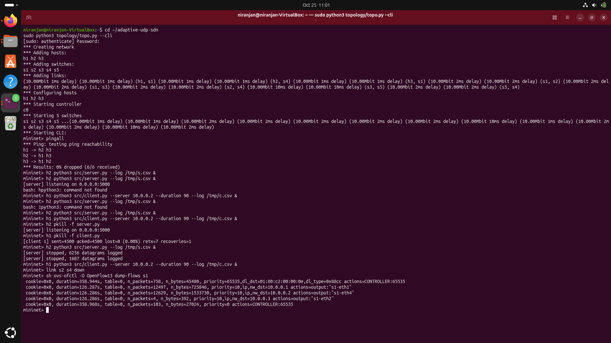
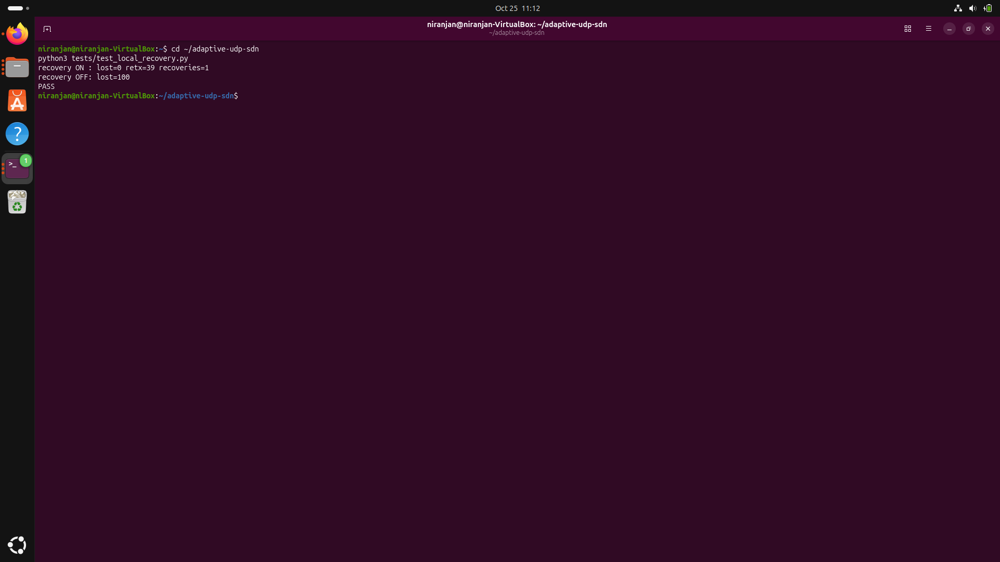
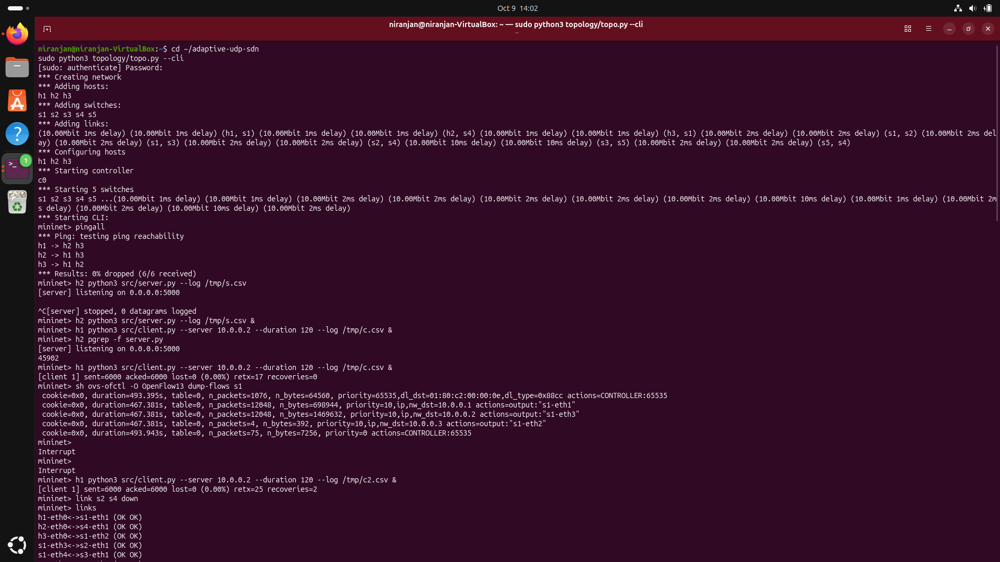
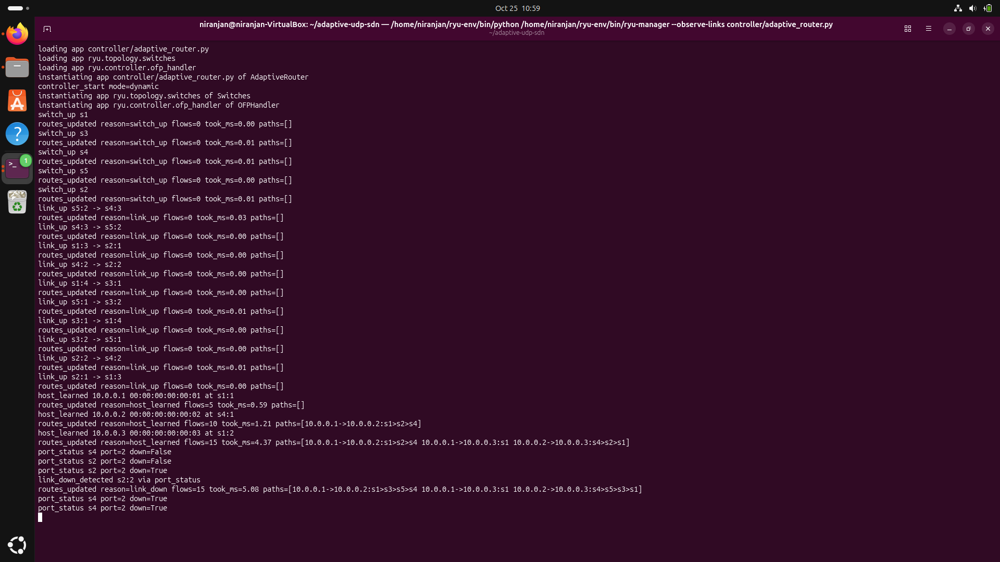
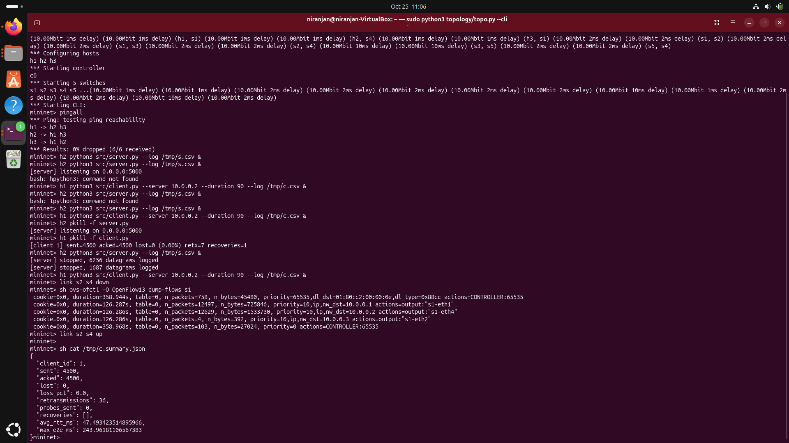

# Adaptive Communication Network with Failure Recovery

### SDN + UDP Socket Programming — Jackfruit Mini Project, Problem 30

**Course:** Computer Networks (UE25CS243A)
**Deliverable:** D1 — Design, Implementation and Initial Testing
**Controller:** Ryu (OpenFlow 1.3)
**Network Emulator:** Mininet 2.3.0
**Switch Software:** Open vSwitch 3.7.1
**Programming Language:** Python 3

---

## 1. Project Overview

Network link failures can interrupt communication between hosts. UDP provides fast, connectionless communication but does not guarantee packet delivery, retransmission, or recovery.

This project implements an adaptive communication network that combines **Software-Defined Networking (SDN)** with **UDP socket programming** to maintain communication during network link failures.

A Ryu SDN controller monitors the network topology, detects link failures, calculates alternative paths, and updates forwarding rules. The UDP application implements application-level acknowledgements, retransmissions, outage detection, and recovery.

The project is developed and tested using Mininet and Open vSwitch.

## 2. Objectives

* Implement UDP communication using low-level Python sockets.
* Create multiple paths between communicating hosts.
* Discover network topology and monitor link status.
* Simulate link failures in Mininet.
* Detect failures and reroute traffic dynamically using SDN.
* Implement application-level recovery for lost UDP messages.
* Evaluate packet loss, latency, retransmissions, and recovery time.

## 3. System Architecture

The network contains three hosts and five OpenFlow switches controlled by a Ryu controller.

* **h1:** UDP client with IP address `10.0.0.1`
* **h2:** UDP server with IP address `10.0.0.2`
* **h3:** Second UDP client with IP address `10.0.0.3`
* **s1–s5:** Open vSwitch switches
* **Ryu controller:** Discovers topology, manages forwarding rules, and handles link failures

### Network paths

**Primary path:**

`h1 → s1 → s2 → s4 → h2`

**Backup path:**

`h1 → s1 → s3 → s5 → s4 → h2`

When the primary link between `s2` and `s4` fails, the controller updates the forwarding rules to use the backup path, provided it remains available.

### Communication flow

1. The UDP client sends numbered DATA datagrams to the server on UDP port `5000`.
2. The server processes each message and returns an ACK.
3. The Ryu controller installs OpenFlow rules to forward packets along the selected path.
4. When a link failure occurs, the controller detects the event and recalculates routes.
5. The client retransmits unacknowledged messages when necessary.
6. When the primary link is restored, the controller can return traffic to the preferred path.

## 4. Repository Structure

```text
adaptive-udp-sdn/
├── README.md
├── requirements.txt
├── .gitignore
├── src/
│   ├── protocol.py
│   ├── server.py
│   └── client.py
├── controller/
│   └── adaptive_router.py
├── topology/
│   └── topo.py
├── tests/
│   └── test_local_recovery.py
├── experiments/
│   ├── run_experiment.py
│   └── run_all.sh
├── analysis/
│   └── analyze.py
├── docs/
├── screenshots/
└── report/
    └── D1_Report.pdf
```

*Note: Include files and folders that exist in your repository. The experiments and analysis scripts support the planned Deliverable 2 evaluation.*

## 5. Technologies Used

| Technology   | Purpose                                    |
| ------------ | ------------------------------------------ |
| Python 3     | UDP application and controller programming |
| UDP sockets  | Application-level communication            |
| Ryu          | SDN controller                             |
| OpenFlow 1.3 | Switch-controller communication            |
| Mininet      | Network emulation and link-failure testing |
| Open vSwitch | Software-based OpenFlow switches           |
| TCLink       | Bandwidth and delay configuration          |
| CSV/JSON     | Experiment logs and result summaries       |

## 6. Installation and Setup

The following instructions assume an Ubuntu environment with administrative privileges.

### Install Mininet and Open vSwitch

```bash
sudo apt update
sudo apt install mininet openvswitch-switch curl -y
```

Verify the installations:

```bash
mn --version
ovs-vsctl --version
```

### Set up the Ryu environment

The project uses a separate Python 3.9 environment for Ryu.

Install `uv` if it is not already installed:

```bash
curl -LsSf https://astral.sh/uv/install.sh | sh
source "$HOME/.local/bin/env"
```

Create the virtual environment and install the controller dependencies:

```bash
uv venv --python 3.9 ~/ryu-env

uv pip install --python ~/ryu-env/bin/python \
  "setuptools<68" wheel pbr

uv pip install --python ~/ryu-env/bin/python \
  --no-build-isolation ryu "eventlet==0.30.2" "dnspython<2"
```

Ensure that Python 3.9 is available before creating the environment.

## 7. Running the Project

Clone the repository:

```bash
git clone https://github.com/<your-username>/adaptive-udp-sdn.git
cd adaptive-udp-sdn
```

Replace `<your-username>` with your GitHub username.

### Terminal 1: Start the Ryu controller

```bash
ROUTING_MODE=dynamic RESULTS_DIR=results/demo \
  ~/ryu-env/bin/ryu-manager --observe-links \
  controller/adaptive_router.py
```

The controller discovers links, maintains the network graph, and installs forwarding rules.

### Terminal 2: Start the Mininet topology

```bash
sudo python3 topology/topo.py --cli
```

At the Mininet prompt, verify connectivity:

```text
mininet> pingall
```

Check that all hosts can communicate before testing a failure.

### Start the UDP server

```text
mininet> h2 python3 src/server.py --log /tmp/s.csv &
```

### Start a UDP client

```text
mininet> h1 python3 src/client.py --server 10.0.0.2 --duration 90 --log /tmp/c.csv &
```

The client sends numbered UDP messages and records acknowledgement and timing information.

## 8. Simulating a Link Failure

With the controller and client running, bring down the primary link:

```text
mininet> link s2 s4 down
```

Inspect the forwarding rules on switch `s1`:

```text
mininet> sh ovs-ofctl -O OpenFlow13 dump-flows s1
```

The controller should detect the link failure, recalculate the route, and direct traffic through the backup path if the implementation and topology are configured correctly.

Restore the link:

```text
mininet> link s2 s4 up
```

Inspect the forwarding rules again to verify whether traffic returns to the preferred primary path.

After the client finishes, inspect its summary:

```text
mininet> sh cat /tmp/c.summary.json
```

### Cleanup

Exit Mininet:

```text
mininet> exit
```

Then clean up the emulated network:

```bash
sudo mn -c
```

Stop the Ryu controller with `Ctrl+C`.

## 9. UDP Application-Level Recovery

The application uses a custom message header containing:

* Message type: DATA, ACK, PROBE, or PROBE_ACK
* Client identifier
* Transmission attempt number
* Sequence number
* Send timestamp

The client tracks acknowledgements and retransmits unacknowledged messages after a timeout. If an outage is detected, it enters recovery mode, sends periodic probes, and resends pending messages after communication is restored.

The application-level recovery mechanism complements SDN rerouting. SDN restores a network path, while the UDP application handles messages that may have been lost during the transition.

## 10. Testing and Initial Results

The following tests are used to evaluate the implementation:

| Test                       | Purpose                                                    |
| -------------------------- | ---------------------------------------------------------- |
| Local UDP recovery         | Compare recovery-enabled and fire-and-forget communication |
| Mininet connectivity       | Verify baseline connectivity with `pingall`                |
| Flow installation          | Inspect OpenFlow forwarding rules                          |
| Link failure detection     | Verify controller response to a failed link                |
| Dynamic rerouting          | Verify selection of the backup path                        |
| UDP traffic during failure | Observe acknowledgements and retransmissions               |
| Link restoration           | Verify recovery of the preferred route                     |

### Initial observations

The current D1 test notes report the following results:

* Local socket test: 0 lost messages with recovery enabled and 100 lost during the simulated blackout with recovery disabled.
* Mininet baseline connectivity: 0% packet loss in the reported `pingall` test.
* Link failure: the controller log reported a route update taking 5.08 ms in the recorded run.
* UDP transmission: 4,500 messages acknowledged, with 36 retransmissions and no reported message loss in a 90-second run.

These are observations from the reported test runs, not guarantees of performance in every run. Results should be reproducible from saved logs and screenshots.

## 11. Screenshots and Documentation

The `screenshots/` directory contains evidence from the D1 test runs:

* Network topology
* Local UDP recovery test
* Mininet connectivity
* Primary-path forwarding rules
* Controller link-failure detection
* Backup-path forwarding rules
* OpenFlow port-down status
* UDP client summary

### Screenshot Gallery

#### Mininet connectivity (`pingall`)



#### Local UDP recovery test



#### Primary-path forwarding rules



#### Controller link-failure detection and rerouting



#### Backup-path forwarding rules


#### UDP client recovery summary



The D1 report is available at:

`report/D1_Report.pdf`

## 12. Deliverable 2: Planned Evaluation

Deliverable 2 will evaluate network resilience under additional conditions.

Planned experiments include:

* Static versus dynamic routing
* Application recovery enabled versus disabled
* Repeated link-failure experiments
* Double-link failures and temporary loss of all available paths
* Link flapping
* Packet loss and retransmission analysis
* Failure detection, reroute, and recovery times
* Round-trip time before and after failover

The analysis scripts will generate tables and plots from experiment results.

## 13. Limitations

* UDP itself does not guarantee delivery.
* Retransmission and acknowledgement logic are implemented at the application layer.
* Recovery depends on the availability of an alternative network path.
* A failure that disconnects all available paths can cause temporary or permanent communication loss until connectivity returns.
* Performance measurements depend on the emulated topology, link configuration, controller behaviour, and experiment conditions.

## 14. Conclusion

This project combines UDP socket programming with SDN-based network management to improve communication resilience during link failures. The controller provides dynamic forwarding updates, while the application implements acknowledgement, retransmission, and recovery mechanisms.

The implementation provides a foundation for further evaluation of failure detection, rerouting performance, packet loss, and latency in Deliverable 2.

---

**GitHub Repository:**
`https://github.com/Niranjan728/adaptive-udp-sdn`

**Course:** Computer Networks (UE25CS243A)
**Project:** Jackfruit Mini Project — Problem 30
